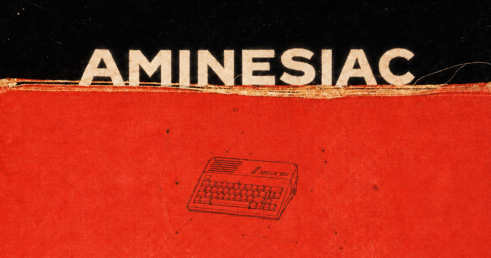

<p align="center">
  
</p>

# aminesiac - AI CODED

**Volatile, dynamically allocated Copy-on-Write snapshots for AmigaOS on PiStorm / Emu68**

`aminesiac` is a native AmigaOS 68k utility that places a RAM-based, sector-level Copy-on-Write (COW) overlay in front of the Raspberry Pi microSD storage exposed by Emu68's `brcm-sdhc.device`. Intercepted writes stay in RAM, while reads see the modified sectors as though they were on disk. A normal Ctrl-Amiga-Amiga warm reset retains the snapshot; a **complete power-off of both the Amiga and Raspberry Pi** discards it.

COW memory is **allocated on demand**, rather than reserving the entire configured snapshot capacity at activation. A small, autonomous Intuition task in the resident also displays **`DISPOSABLE SESSION!`** on the Workbench title bar to remind the user that changes are temporary. No separate indicator program or WBStartup entry is required.

This is not a file copier, a filesystem driver, an HDF emulator, or a modified Emu68 build. AmigaOS and its existing filesystem continue to see an ordinary block device.

> [!WARNING]
> **Experimental storage interception — use only a disposable, fully backed-up clone of your microSD.** Functional rollback and clean filesystem checks do **not** prove that no physical sector was written. See [Safety and limitations](#safety-and-limitations) before enabling it.

## Why this matters

A modern storage-snapshot technique can run **inside an authentic 1990s operating system**, without replacing AmigaDOS or the filesystem, running Linux underneath it, or permanently modifying the SD driver. The project combines five mechanisms:

1. **Native Exec device interception.** Standard AmigaOS `SetFunction()` hooks intercept block-device I/O below the filesystem, including ordinary file data and filesystem metadata updates.
2. **Dynamic COW allocation.** A hash table is reserved at activation, while sector data grows in small FAST+KICK blocks as distinct disk sectors are modified. Unused snapshot capacity does not occupy the full corresponding data RAM.
3. **Warm-reset persistence.** A COLDSTART resident and `KickMem` preserve the COW mapping and its dynamically registered FAST RAM blocks across supported Ctrl-Amiga-Amiga resets, then restore the device interception path during boot.
4. **Two different lifetimes.** AmigaOS can restart while PiStorm/Emu68 snapshot memory is retained. A complete hardware power-off ends that memory lifetime and restores the underlying disk's observable state, except for any actual physical writes outside or bypassing the protection window.
5. **Resident visual warning.** The module itself creates a minimal Workbench banner, **`DISPOSABLE SESSION!`**, when the worker and SD interception hooks are operational. The banner is independent of the storage I/O worker and requires no startup script.

The result demonstrates how the original AmigaOS/Exec resident, memory and device interfaces can support a modern-style, volatile storage service. PiStorm provides the RAM and favorable warm-reset behavior; AmigaOS provides the native system abstractions.

### File deletions are reversible too

**aminesiac can roll back created files, modified files and deletions.** Files deleted during a protected session were confirmed to reappear after a complete power cycle on the tested PFS3 volume. There is no need to copy a deleted file's entire contents into the COW solely because it was deleted: the original data remains on the underlying card, while the overlay generally captures changes to directory entries, allocation maps and other filesystem metadata. Actual COW usage depends on the sectors written by the filesystem and applications; deleting a very large file does not necessarily consume a comparable amount of snapshot memory.

### I/O model

```text
Amiga applications / AmigaDOS
               |
     PFS3 / FFS / other filesystem
               |
       Exec device I/O
               |
   aminesiac BeginIO/AbortIO hooks
          /              \
  COW sector present?     Original brcm-sdhc.device
          |                       |
  Read from RAM            Read missing sectors
  Write into RAM           from physical microSD
          \_______________________/
               |
       Coherent logical disk
```

The overlay is **sector-based (512 bytes)**. Unit 0 (whole-card offsets) and unit 1 (offsets relative to the recognized Amiga partition) map into the same physical-sector address space, so aliases remain coherent. Reads combine unchanged physical sectors with RAM-backed modified sectors.

A serialized worker handles COW operations and, when needed, allocates blocks **before** committing a write. No storage allocation is performed inside the `BeginIO` hook itself. If a write cannot fit or memory allocation fails, it is rejected without forwarding that write to the physical driver. Unknown or potentially write-capable commands are also rejected rather than silently passed through. These safeguards do **not** make the program a hardware write blocker.

## Dynamic COW memory

`MEM=N` specifies the **maximum payload capacity**, in MiB, not the amount of sector-data RAM allocated immediately. `N` can be any integer from **4 to 128**, including values such as `MEM=100`.

- At `ARM`, the resident allocates a fixed-size hash table in FAST+KICK RAM, plus small persistent structures in CHIP RAM.
- Modified sectors are stored in blocks of **2,048 sector records**. Each block holds **1 MiB of sector payload** plus 16 KiB of sector metadata (**1,064,960 bytes per block**).
- A new block is allocated only when the current blocks cannot hold the additional *distinct* sectors in an incoming write. Rewriting an LBA already in the COW updates its existing record.
- Each allocated block is registered in `KickMem`; the checksum and block directory are updated so the block can be recovered after a supported warm reset.
- Allocation only grows during a session. Blocks are not individually reclaimed; the complete snapshot disappears at full power-off.

For example, `MEM=4` offers 8,192 modified-sector slots. Its initial FAST+KICK hash allocation is **64 KiB**, with sector-data blocks added on demand. `MEM=100` offers 204,800 slots; its hash initially uses **2 MiB**, and its sector-data RAM grows in approximately 1.016 MiB increments as needed, up to the configured capacity. Additional resident overhead applies in both cases.

The hash reservation is contiguous, and each newly allocated block must also fit into a suitable FAST+KICK region. A large total amount of free RAM does not guarantee that each block allocation will succeed. Leave adequate RAM for AmigaOS and applications.

### When the COW fills up

The write path is designed to **fail closed**: it does not fall back to writing to the real microSD when the COW is full or a required allocation fails. The resident reports a device I/O error and counts rejected requests in the `full` field of `STATUS`. The error currently used is **`-3`**; PFS3 may display its unsigned 32-bit equivalent, `4294967293`, rather than an AmigaDOS “Disk full” message.

This condition can disrupt the **virtual** filesystem. In an actual `MEM=4` capacity test, PFS3 displayed a write error and the overlaid volume became `NDOS` after cancellation. After a **complete power cycle**, the physical volume was again accessible and working normally, and PFSDoctor reported **zero errors**. This is a functional recovery result on the tested configuration, not a guarantee for all media or a sector-by-sector physical write-protection proof.

**If the COW fills or PFS3 reports an I/O error, stop using the volume and power off both the Amiga and Pi completely.** Do not keep retrying writes or run filesystem repair against the active volatile view.

## Automatic Workbench warning

Once the COW worker is initialized and a Workbench public screen is available, the resident opens a small Intuition title-bar window at the top right, displaying exactly:

```text
DISPOSABLE SESSION!
```

- It appears after the **first successful `ARM`** without requiring a reboot, and is created again after a supported **warm reset**.
- There is **no separate executable**, WBStartup entry, external program, Workbench patch or Emu68 modification.
- The text is fixed: there is no memory percentage, clock or periodic text refresh.
- The visual task waits if Workbench is not open; it does **not** launch Workbench. The COW continues to work in CLI-only sessions, without a banner.
- A lightweight status check monitors the worker and the live `BeginIO`/`AbortIO` hooks. If the resident becomes unhealthy, the window is closed. Visual failure must not prevent COW operation.
- The window belongs to the Workbench screen: applications using separate screens may cover it.

**The banner is a reminder, not proof of physical write isolation.** Its health check deliberately does not require the Exec `OpenDevice` vector to keep matching the resident after a warm reset; see [Reading `STATUS`](#reading-status).

## Requirements and compatibility

| Component | Requirement |
| --- | --- |
| Computer | Amiga with PiStorm and Emu68; hardware-tested on an Amiga 600 / Raspberry Pi 3A+ setup |
| Operating system | AmigaOS with Exec version 39 or newer; not all Kickstart/Workbench versions have been tested |
| Storage driver | `brcm-sdhc.device` with compatible standard Exec `BeginIO`/`AbortIO` vectors |
| Media geometry | 512-byte sectors, MBR partition table, **exactly one primary type `0x76` partition** |
| Device units | Unit 0 exposes the full card; unit 1 exposes that `0x76` partition; reported geometry and sampled contents must agree |
| Memory | FAST+KICK RAM for the hash and individual COW blocks, plus a small CHIP RAM allocation for persistent state/code |
| Filesystems | Transparent at the supported block-device interface; PFS3 has been exercised on real hardware |
| Workbench display | Optional Workbench public screen with Intuition for the automatic visual warning; COW itself does not require Workbench |

Compatibility is checked through Exec vector format, device geometry, unit mapping and sampled media reads, not by hard-coding driver-version numbers, Git revisions, absolute function addresses or private driver offsets. This is *build-independent by design*, **not** a claim of compatibility with every `brcm-sdhc.device` release.

Other storage drivers including `brcm-emmc.device`, GPT layouts, multiple `0x76` partitions and arbitrary SCSI-direct commands are not currently supported. A successful `PROBE` is necessary but insufficient evidence of complete compatibility.

## Quick start

**Make and independently verify a full backup first, and use a disposable clone.** Completely power off both Amiga and Raspberry Pi before inserting the card or changing binaries.

Place these **two files together** in the same Amiga directory, then run commands from that directory:

```text
aminesiac
aminesiac.R4Module
```

Perform the non-installing compatibility check:

```text
Stack 65536
aminesiac PROBE
```

A successful probe reports:

```text
[PROBE] PASS: read-only compatibility checks. No hooks installed.
```

If the probe passes and you accept the risks, activate a snapshot with up to 32 MiB of modified-sector payload:

```text
aminesiac ARM MEM=32 I_ACCEPT_RISK
aminesiac STATUS
```

On the first ARM, expect a ready worker (`52445932`, or `RDY2`), `faults=0`, `full=0`, `checksum=PASS` and the device `BeginIO`/`AbortIO` gates reporting `PASS`. At initial activation the four inspected gates are normally `PASS`. With Workbench open, **`DISPOSABLE SESSION!`** should also appear automatically in its title bar.

**Do not run `ARM` again after a warm reset.** The resident restores the virtual disk session during reboot. There is no `DISARM` command. Only a complete power-off of **both** the Amiga and Raspberry Pi discards the volatile snapshot.

## Command reference

The supported commands are:

```text
aminesiac PROBE
aminesiac ARM MEM=N I_ACCEPT_RISK
aminesiac STATUS
```

| Command | Purpose |
| --- | --- |
| `PROBE` | Non-installing checks of driver vectors, geometry, partition mapping and sampled media reads; intended for an unarmed system. |
| `ARM MEM=N I_ACCEPT_RISK` | Installs `aminesiac.R4Module`, allocates the persistent hash/state, registers the resident and hooks the SD device. Sector-data blocks are allocated subsequently as needed. **Changes system state.** |
| `STATUS` | Reads persistent state, COW capacity/usage, dynamically allocated blocks, KickMem checksum, media fingerprint and current vector targets. Does not arm or disarm. |

### `MEM=N` — maximum snapshot capacity

`MEM=N` accepts every integer **4 through 128**, in MiB. It is **not** restricted to powers of two.

```text
aminesiac ARM MEM=16 I_ACCEPT_RISK
aminesiac ARM MEM=32 I_ACCEPT_RISK
aminesiac ARM MEM=100 I_ACCEPT_RISK
```

These are **alternatives for separate cold-start sessions**, not commands to run consecutively. For example, `MEM=100` allows up to **204,800 distinct modified 512-byte sectors**. It does not allocate 100 MiB of sector-data RAM at startup; see [Dynamic COW memory](#dynamic-cow-memory).

### Reading `STATUS`

Example immediately after a successful first block allocation (addresses and counters vary):

```text
[RESIDENT] boots=1 arms=1 worker=52445932 faults=0
[COW] used=115/8192 sectors allocated=1/4 blocks (1 payload MiB)
[COW] writes=10 reads=18 changes=10 busy=00000000 full=0
[KICK] entries=6 base=5 checksum=PASS
[GATE] Exec AddDevice=... expected=... PASS
[GATE] Exec OpenDevice=... expected=... PASS
[GATE] brcm device=... BeginIO=... expected=... PASS
[GATE] brcm AbortIO=... expected=... PASS
[STATUS] ACTIVE-GATED: vectors match; physical isolation NOT independently proven
```

- `boots`: COLDSTART initialization count, including warm resets.
- `arms`: successful worker-initialization count; it can increase after warm reset **without** a new `ARM` command.
- `worker=52445932`: the `RDY2` readiness marker; `faults=0` is the expected healthy state.
- `used/capacity`: distinct COW sectors held / maximum sector slots. Each sector is 512 bytes; capacity equals `N × 2048` sectors.
- `allocated=A/B blocks`: 1 MiB-payload blocks currently allocated / maximum permitted for `MEM=N`. The physical RAM per block also includes metadata.
- `writes`, `reads`, `changes`: activity counters, not evidence of physical-media immutability.
- `busy=00000000`: no COW write-transaction busy marker at the time sampled.
- `full`: number of write requests rejected due to capacity or required allocation failure; normally zero.
- `KICK ... checksum=PASS`: KickMem bookkeeping and checksum agree at the time checked.
- `fingerprint`: sampled-media consistency value, **not** a cryptographic whole-card digest.

**Known warm-reset behavior:** on the tested Kickstart, `ramlib` can replace the Exec `OpenDevice` vector after COLDSTART. Consequently, `STATUS` may show `OpenDevice ... FAIL` and the summary `NOT VERIFIED` even when the COW worker and the SD driver `BeginIO`/`AbortIO` hooks are still present. The resident Workbench banner intentionally does **not** use `OpenDevice` as a display condition. This known interaction must **not** be mistaken for independent proof of safe physical write isolation. If the SD hooks fail, the worker faults, or any other unexpected state appears, stop writes and investigate on a disposable clone.

## Recommended operational procedure

The following procedure is intentionally conservative. Use **only disposable data on a cloned card**.

1. **Cold start:** fully power off the Amiga and Raspberry Pi, then boot from the clone. Filesystem activity **before `ARM`** is outside the protected session.
2. **Preflight:** open a CLI, run `Stack 65536` and `aminesiac PROBE`. Stop if the probe fails.
3. **Arm once:** run `aminesiac ARM MEM=32 I_ACCEPT_RISK` (or another chosen maximum), then `aminesiac STATUS`. If Workbench is open, verify the automatic `DISPOSABLE SESSION!` warning.
4. **Exercise the overlay:** on a disposable volume backed by the supported `0x76` partition, for example if it is mounted as `SDH1:`:

   ```text
   Echo "AMINESIAC_TEST" >SDH1:AMINESIAC.TEST
   Type SDH1:AMINESIAC.TEST
   aminesiac STATUS
   ```

5. **Warm reset:** use Ctrl-Amiga-Amiga **without powering down the Pi**. Do not rerun `ARM`. Verify that the file persists in the virtual disk; when Workbench reopens, the resident warning should reappear automatically.
6. **End the session:** completely power off both machines. On the next cold boot the temporary test file should be gone; files deleted only inside the virtual session should be restored.
7. **Inspect the underlying filesystem:** use a non-destructive check, such as PFSDoctor for PFS3, after leaving the volatile session. Keep backups and compare against a known baseline when physical integrity matters.

Stop disk activity on unexpected I/O errors, worker faults, invalid KickMem checksum, driver-gate changes or COW exhaustion. Do not attempt filesystem repair while the overlay is active.

## Safety and limitations

### Not a physical write-protect mechanism

`aminesiac` hooks the AmigaOS device I/O path. It does **not** modify the Raspberry Pi SD controller or create hardware-level write protection:

- Writes performed **before ARM** may already have reached the real card. PFS3 may modify metadata while mounting a volume.
- Driver-private I/O, unforeseen commands, code bypassing the hooks, or unexpected boot ordering could still write to the underlying medium.
- `PROBE`, `STATUS`, the visual banner, successful functional rollback and a clean PFSDoctor run do not independently prove sector-for-sector physical immutability.
- The geometry and unit/partition checks examine samples, not every physical sector.

A whole-device SHA-256 calculated across separate boots may differ because of pre-ARM activity. Investigate such differences at sector level rather than treating them as automatic proof for or against an isolation breach.

### No live deactivation, commit or durable snapshot

There is no `DISARM`, `COMMIT` or snapshot-save operation. The intended way to discard the volatile COW is a complete power-off of both Amiga and Raspberry Pi. Warm reset **retains** the session, including any virtual filesystem inconsistency that may have developed.

A full power cycle is also the safe boundary for changing binaries or selecting another `MEM` limit. Do **not** run disk repair, partitioning, formatting, firmware updates or destructive storage tools while armed. When the COW becomes full, the filesystem may receive errors and its volatile view may become unusable; stop I/O and power off completely.

### Supported I/O surface is deliberately narrow

The worker supports normal read/write commands, selected update/flush operations and known safe control commands. Unknown write-capable operations, unusual unit layouts, unsupported SCSI-direct commands and media changes are not assumed safe; some tools may therefore encounter errors instead of operating transparently.

Boot ordering and Exec vector ownership can vary. In particular, the known `ramlib` replacement of `OpenDevice` after warm reset is accounted for by the resident visual task, but it does not establish universal compatibility or eliminate the need for careful `STATUS` checks. Do not treat a visual banner as a security certification.

### Power loss and RAM-only data

Removing power destroys **all** snapshot changes, including files created, modified, deleted, installed or configured in the disposable session. Crashes or abnormal resets can interrupt an operation and may leave the temporary snapshot inconsistent. Never rely on COW data as durable storage or test with irreplaceable media.

## Build from source

On Linux, install the AmigaOS 68k cross compiler `m68k-amigaos-gcc`, Amiga NDK headers, `make`, Python 3 and a host C compiler. From the source directory:

```sh
make clean
make test-host
make CC=m68k-amigaos-gcc \
     NDK_INCLUDE=/path/to/ndk-include \
     AMIGA_CRT=-mcrt=nix20 \
     all

ls -lh aminesiac aminesiac.R4Module
```

Deploy the two binaries **together**. `aminesiac` loads `aminesiac.R4Module` from the current working directory when arming. The loader checks module compatibility; mixing unrelated builds may fail and is not supported.

The visual component is linked into the resident module: **no extra binary, startup script, WBStartup entry, Emu68 patch or replacement filesystem** is needed. Host-side tests do not replace native AmigaOS builds and real-hardware validation.

## Hardware validation

On the tested Amiga 600 / PiStorm / Emu68 configuration with `brcm-sdhc.device` 1.9 and PFS3, the following functional results have been reported:

- Dynamic block allocation and registration in KickMem, with a valid updated checksum and functioning disk I/O.
- Persistence of the COW state through **three warm resets** in a dynamic-allocation test.
- Restoration of deleted files after a complete power cycle.
- Intentional COW exhaustion at `MEM=4`, with error propagation to PFS3; after full power cycle the physical volume was again usable and PFSDoctor reported **zero errors**.
- Successful hardware tests of the **integrated resident Workbench warning**: automatic appearance after first `ARM` and return after warm reset, without an external program or WBStartup entry.

These are functional results from the reported hardware tests, not a sector-by-sector physical write-isolation certification. The visual test was reported as passing as a whole; detailed machine logs for that specific build are not included here. Expansion across multiple newly allocated COW blocks and absolute physical-card immutability have not been independently confirmed by the cited tests. Other Kickstart versions, screen configurations, drivers and partition layouts require their own validation.

## Credits and acknowledgments

**Michal Schulz** ([`michalsc`](https://github.com/michalsc)) is the author of **Emu68 and `brcm-sdhc.device`**, whose native AmigaOS storage interface makes this project possible. His work on the Raspberry Pi SD host driver and Emu68's AmigaOS integration is fundamental to `aminesiac`.

- [Emu68 project](https://github.com/michalsc/Emu68)
- [Emu68 SD card preparation and device-unit documentation](https://github.com/michalsc/Emu68/blob/master/docs/tutorials/SD_Preparation.md)
- [Emu68 configuration options](https://michalsc.github.io/Emu68/Options.html)

`aminesiac` is an independent AmigaOS-side utility, not an official Emu68 component. No endorsement by the upstream author is implied.

---

**The essential idea:** AmigaOS still sees an ordinary disk. The snapshot grows dynamically in RAM, survives supported warm resets and disappears when PiStorm memory loses power. The on-screen **`DISPOSABLE SESSION!`** warning makes the temporary nature of the session visible without adding an external program. This is both a practical experimental tool and a demonstration of the continuing technical relevance of AmigaOS's original resident, memory and device interfaces.
